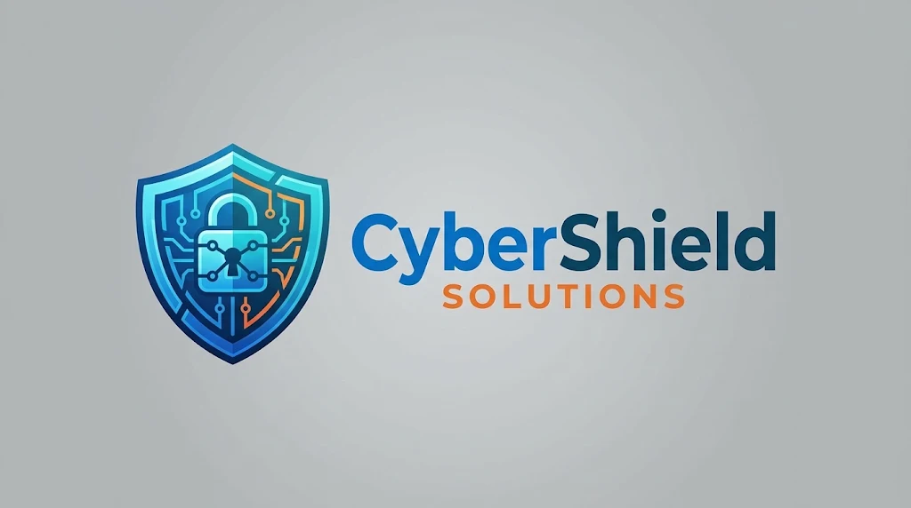

<h1 align="center">Práctica 1 - Datos generales de la empresa</h1>
 

<b>Nombre: </b>Israel Moreno Ballesta

<b>Curso: </b>CETI

<b>Asignatura: </b>Normativa de Ciberseguridad

# ÍNDICE

- [Datos generales de la empresa](#datos-generales-de-la-empresa)
- [Descripción](#descripción)
- [Logo](#logo)

## Datos generales de la empresa

- <b>Nombre:</b> CyberShield Solutions

- <b>Breve descripción de la función de la empresa:</b> Empresa especializada en servicios de ciberseguridad, mantenimiento de redes y soporte informático a pequeñas y medianas empresas.

- <b>Tamaño de la empresa:</b> Pequeña empresa (12 empleados).

## Descripción

- <b>Descripción de la empresa:</b> CyberShield Solutions nace para ofrecer a las pymes soluciones informáticas integrales y protección frente a amenazas cibernéticas, permitiendo que sus clientes se concentren en su negocio sin preocuparse por la seguridad de sus datos.

- <b>Tipo de actividad que realiza:</b> Sector Servicios / Tecnologías de la Información y Comunicación (TIC) / Ciberseguridad y Asistencia Técnica.
 
- <b>Sistemas de información que puede tener la empresa:</b>

  - Servidores: Servidor local de archivos (NAS) para copias de seguridad de la red interna y un servidor para la gestión de acceso de usuarios.
    
  - Servicios en la nube: Microsoft 365 para correo corporativo y gestión documental, y AWS para el alojamiento de la web y bases de datos.
    
  - Gestión de incidencias: Sistema helpdesk para registrar y atender las peticiones de soporte de los clientes.
    
  - Red y seguridad: Firewall perimetral, sistema de prevención de intrusos (IPS) y red privada virtual (VPN) para el teletrabajo seguro.

## Logo

